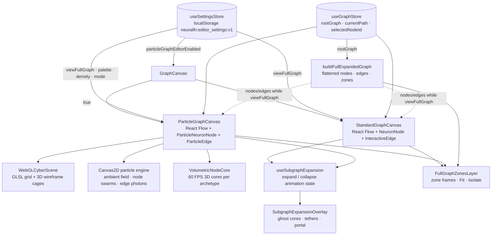
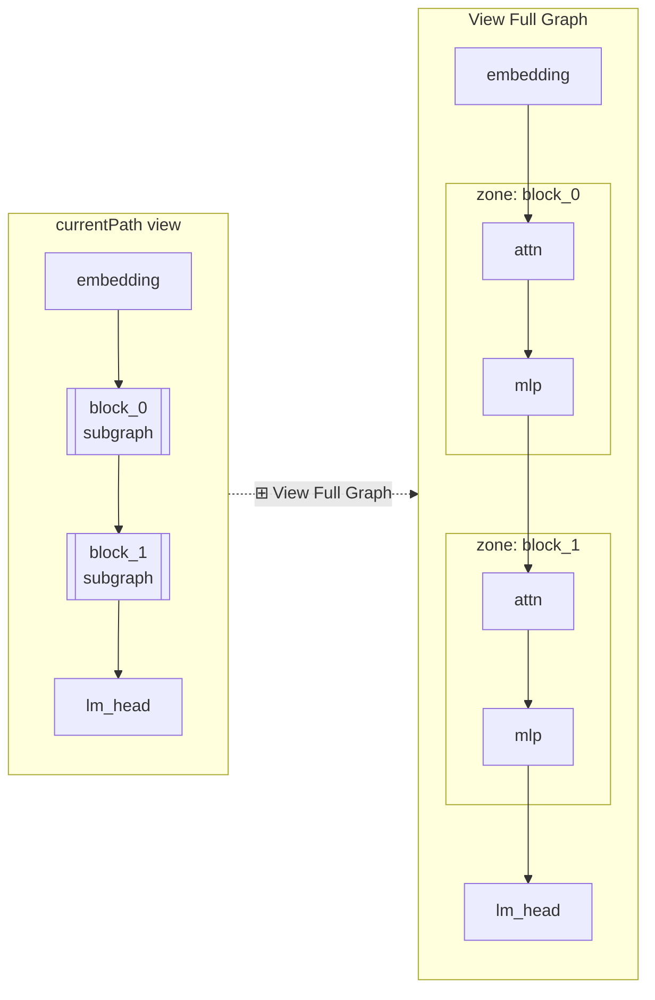
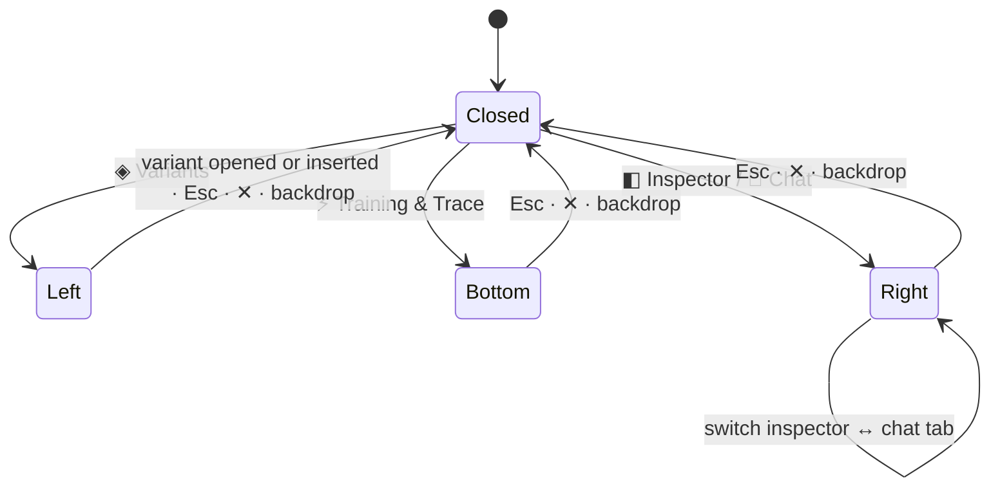

# Cyber Mode, Full Graph View, and Panel Dialogs

This page is the workflow guide for the editor features that share the settings store: the feature-flagged **Volumetric 3D Cyber** graph canvas, the persisted **settings** that drive it, **View Full Graph** mode (every nested subgraph flattened onto one canvas), the animated **subgraph expand / collapse** choreography, the categorized **node picker**, and the full-screen canvas layout with on-demand **panel dialogs**. All of these work in both the standard 2D canvas and the cyber canvas unless stated otherwise.

Reference pages: [Store](store.md#settings-store-usesettingsstore) for every settings field and action, [Graph Utilities](graph-utils.md#full-graph-expansion) for the full-graph builder, [Components](components.md) for component-level detail, and [Pages](pages.md#editorpage) for the `EditorPage` layout.

## How the pieces fit together



`GraphCanvas` is a thin switch: it reads `particleGraphEditorEnabled` and renders exactly one of the two canvases, so only the active canvas owns the React Flow viewport and the expansion hook. Everything the two canvases share (full-graph flattening, zone frames, expand/collapse choreography) lives in `graphUtils.ts` and `SubgraphExpansionOverlay.tsx` and is wired into both.

## Where the controls are

| Control | Where | What it calls |
|---------|-------|---------------|
| `✦ Cyber 3D` / `✦ Cyber 3D: ON` | `Toolbar` | `toggleParticleGraphEditor()` |
| `2D` | cyber HUD (top-right) | leaves cyber mode (`particleGraphEditorEnabled = false`) |
| `⚙` | `Toolbar`; `⚙ Settings` in the `AppShell` header; `⚙ Configure Holographic & Particle Settings...` in `CodePanel` graph settings; `⚙` in the cyber HUD | `setSettingsOpen(true)` opens `SettingsModal` |
| `⊞ View Full Graph` / `⊞ Full Graph: ON` | `Toolbar`; `FULL GRAPH: ON/OFF` in the cyber HUD; `⊞ View Full Graph (Expand All Subgraphs)` checkbox in `SettingsModal` | `toggleViewFullGraph()` / `setViewFullGraph()` |
| `✦ + Add Node` | `Toolbar` | opens `NodePickerModal` (component-local state) |
| `+ Custom Node`, `+ Override`, `+ Subgraph` | `Toolbar` and the picker's quick-spawn row | `addCustomNode`, scalar override node, `addSubgraphNode` |
| `◈ Variants` | `Toolbar` and the left canvas edge | `setActivePanelDialog("left")` |
| `⚡ Training` / `⚡ Training & Trace` | `Toolbar` and the bottom canvas edge | `setActivePanelDialog("bottom")` |
| `◧ Inspector` | `Toolbar` and the right canvas edge | `openRightPanelDialog("inspector")` |
| `💬 Chat` / `💬 Model Chat` | `Toolbar` and the right canvas edge | `openRightPanelDialog("chat")` |
| breadcrumbs | `Toolbar` (and the cyber HUD breadcrumb strip) | `setViewFullGraph(false)` then `setPath(crumb.path)`; the shorter path triggers the collapse animation |
| `3D TILT: ON/OFF`, color matrix cycler, `⚡ PULSE`, recenter, tactical radar | cyber HUD only | `setHoloPerspective3D`, `setColorPalette`, `triggerPulse`, `fitView`, click-to-warp camera |

## Settings and persistence

`SettingsModal` edits the persisted subset of `useSettingsStore`: the cyber-mode flag, visual mode (`hybrid_hud` / `particle_nebula`), one of four palettes from `PARTICLE_PALETTES`, particle density (`balanced` / `high` / `ultra`), motion intensity (`smooth` / `cinematic`), the 3D tilt and HUD telemetry checkboxes, and the View Full Graph checkbox. Picking a visual mode while cyber mode is off also turns cyber mode on. A reset button restores the defaults.

Everything persisted is stored as one JSON object under the `localStorage` key `neuralfn:editor_settings:v1`, is validated field-by-field on load, and is never sent to the server. The defaults are cyber mode **off**, `hybrid_hud`, `cyber_plasma`, density `high`, motion `cinematic`, tilt **off**, HUD **on**, View Full Graph **off**. Dialog state (`activePanelDialog`, `rightPanelTab`, `isSettingsOpen`) and the pulse counter are transient.

## The cyber canvas

When `particleGraphEditorEnabled` is true, `ParticleGraphCanvas` renders three stacked layers underneath React Flow:

1. **`WebGLCyberScene`** -- one shared `webgl2` / `webgl` context drawing a GLSL perspective grid floor and a rotating wireframe cage around every node. It receives the node anchors (`id`, flow `x` / `y`, archetype `rgb` / `secondaryRgb`, `selected`, `seed`), the React Flow viewport, the active palette's primary / secondary / accent colors, and `isTraining`.
2. **The Canvas2D particle engine** -- an ambient curl-noise field, a per-node orbital swarm whose shape is the archetype's `swarmGeometry`, double-helix photon packets along every edge, and burst / shockwave rings on spawn, pulse, and transitions. Particle budgets follow `particleDensity`; retargeting uses damped springs tuned by `motionIntensity`.
3. **React Flow** with `ParticleNeuronNode` and `ParticleEdge`. In `hybrid_hud` mode each node is a five-plane CSS `preserve-3d` chassis with cursor-tilt parallax around a `VolumetricNodeCore`; in `particle_nebula` mode nodes collapse to the core plus a laser callout banner.

Every node is classified once by `resolveNodeArchetype(label, neuronDef, isInput, isOutput)` into one of 14 archetypes. Subgraph nodes are always `citadel_subgraph`; graph inputs, `input`, and `*_source` nodes are `portal_input`; graph outputs, `output`, `lm_head`, and `denoise_head` are `portal_output`; the remaining rules are substring matches on the lower-cased label, neuron name, and `module_type` (for example `mamba` / `ssm` / `ttt_` → `sequence_wave`, `attention` / `sdpa` → `attention_prism`, `moe` / `router` / `expert_` → `moe_router`, `lora` / `nf4` → `lora_adapter`, `linear` / `mlp` / `swiglu` → `tensor_matrix`, `norm` / `dropout` / `softcap` → `norm_stabilizer`, `embedding` / `rotary` / `kv_cache` → `memory_vault`, `loss` / `dpo` / `ppo` / `reward` → `objective_beacon`). Anything else is `signal_modulator`. The archetype supplies the silhouette `clipPath`, neon color pair, badge text, swarm geometry, and the 3D core geometry drawn by `VolumetricNodeCore`. The full table is in [Components](components.md#particleneuronnode-volumetricnodecore--particleedge).

The HUD adds `FULL GRAPH`, visual-mode, `3D TILT`, palette, `⚡ PULSE`, recenter, `⚙`, and `2D` buttons along the top, and a tactical radar in the bottom-right corner whose blips warp the camera to the clicked node.

## View Full Graph mode

Turning `viewFullGraph` on makes the active canvas render `buildFullExpandedGraph(rootGraph, [])` instead of the graph at `currentPath`. Every nested subgraph (up to 6 levels deep) is expanded inline inside a labelled **zone**; the `input` / `output` terminals of nested subgraphs are removed and their wiring is bridged straight through, so residual streams and block internals connect end-to-end across the whole architecture.



What changes while the mode is on:

- **Layout is computed, not stored.** Nodes are re-laid out into columns (see [Graph Utilities](graph-utils.md#buildfullexpandedgraphrootgraph-startpath--)); their saved positions are untouched. The canvas calls `fitView` 60 ms after the toggle flips.
- **Zones are interactive.** `FullGraphZonesLayer` draws each zone's frame, name, breadcrumb, `family@version` badge, and node count in a depth-coloured style (amber, cyan, violet, emerald cycling by depth). `⌖ Fit` animates the viewport to the zone; `⤢ Isolate` turns View Full Graph off and navigates to the zone's path, which is the normal way to drill in from this view.
- **Editing is limited to selection and the inspector.** Drags, edge changes, and new connections are ignored. Clicking a nested leaf selects it by its scoped id (`fullg::<path>::<nodeId>`); `selectSelectedNode` synthesizes a node with `subgraphPath`, `instancePath`, `localNodeId`, and a `breadcrumbLabel`, and `CodePanel` edits through `updateNodeData` / `removeNode`, which resolve the id back to the owning subgraph or variant-library entry.
- **Breadcrumbs still work.** Clicking a crumb turns the mode off first, then navigates.
- **Both canvases.** The standard canvas and the cyber canvas use the same builder and zone layer; the cyber canvas additionally re-targets its particle swarms to the new positions.

## Subgraph expand and collapse animation

With View Full Graph off, clicking (or double-clicking) a subgraph node runs a 2000 ms, three-stage expansion driven by `useSubgraphExpansion`; clicking an ancestor breadcrumb plays the reverse. The hook is owned by whichever canvas is active and feeds animated node / edge arrays to React Flow while the choreography runs.

```mermaid
sequenceDiagram
  participant U as User
  participant C as Active canvas
  participant H as useSubgraphExpansion
  participant S as useGraphStore
  U->>C: click subgraph node
  C->>H: triggerSubgraphExpansion(node)
  H->>S: openSubgraph(nodeId)  (currentPath advances immediately)
  Note over H: snapshot parent view + viewport<br/>remember node id and zoom per depth
  loop requestAnimationFrame for 2000 ms
    H-->>C: animatedNodes / animatedEdges / expansionState
    H-->>C: setViewport (camera pulls toward center)
  end
  H-->>C: expansionState = null (child graph shown normally)
  U->>C: click ancestor breadcrumb
  C->>S: setViewFullGraph(false); setPath(ancestorPath)
  S-->>H: currentPath is now a strict prefix of the previous path
  H->>H: startSubgraphCollapse(previous snapshot)
  loop requestAnimationFrame for 2000 ms
    H-->>C: children converge into the parent node's core
  end
  H-->>C: expansionState = null (parent graph shown normally)
```

Expansion timeline (`p` is normalized time):

| Stage | `p` | What happens |
|-------|-----|--------------|
| 1 -- center-seeking burst | 0.06 → 0.34 | The clicked node's title plate detaches upward (`titleDetached`), the node drifts toward the canvas centre, and one clone of its 3D core per child node is emitted outward along that direction into a halo ring (`coreMorphProgress = 0`, `shellExpandProgress = 0`, `coreOnlyMorph = 1`). Children are emitted one after another inside the `p` 0.06 → 0.30 window, evenly spaced around a ring whose radius grows with the child count (125–200 px). |
| 2 -- simultaneous transit and wireframe morph | 0.34 → 0.82 | Every emitted core glides to its final child position while `VolumetricNodeCore` interpolates its 3D wireframe segments from the parent's archetype (`coreMorphFrom`) to the child's own (`coreMorphProgress` 0 → 1). |
| 3 -- shell growth | 0.82 → 1.00 | Each child's outer box, border, ports, and labels grow outward from its core (`shellExpandProgress` 0 → 1) and the overlay fades. |

Collapse reverses the order: children lose their shells, morph their wireframes back toward the parent archetype, and converge into the parent node's exact on-screen core. The hook measures that target from the live DOM (`.react-flow__node[data-id="<parent>"] canvas`) so the convergence point tracks the real rendered size (`singularityCoreSize`), and it restores the zoom level recorded when the subgraph was entered. During morphing, additive blending, halos, shimmer rings, and shockwaves are suppressed so cores keep their own colours and fade without glow artefacts.

`SubgraphExpansionOverlay` renders the parts that are not React Flow nodes: sibling ghosts that drift aside, collapsing child ghosts, fading edge ghosts, emerging-node tethers, and the portal / title plate at the parent's position. In the cyber canvas it also asks the particle engine for spawn bursts through `onSpawnBurst`.

## Node picker

`✦ + Add Node` opens `NodePickerModal`, which replaces the old wall of per-builtin toolbar buttons. The modal lists every builtin from `useGraphStore.builtins` in nine categories (`PICKER_CATEGORIES`): Attention & Sequence Mixers, Linear / MLP & Adapters, MoE Routing & Experts, JEPA / Latent & World Models, Embeddings / RoPE & KV Memory, Norms / Residuals & Gating, Fine-Tuning / RLHF & Losses, Activations & Math Primitives, and Subgraphs / I/O & Data Sources. Each category is colour-coded by its archetype, cards animate in with a staggered fan-out, a search box filters by name, quick-spawn buttons add a custom Python node, a scalar override, or an empty subgraph, a multi-drop toggle keeps the modal open after inserting, and the right-hand blueprint inspector previews the selected builtin's ports and 3D glyph. Insertion goes through `addBuiltinNode` at the canvas's preferred insert position.

## Full-screen canvas and panel dialogs

`EditorPage` gives the whole stage below the toolbar to the canvas and moves the former side panels into three modal dialogs (`activePanelDialog`):



- **Left -- Variant Matrix & Subgraph Library** (`LibraryPanel`): saved variant families and versions; opening or inserting one closes the dialog via `onDone`. Rendered only while open.
- **Bottom -- Training, Telemetry & Torch Trace** (`TrainingPanel`): training configuration, dataset / JSON inputs, the Recharts loss curve, and the torch trace. Kept mounted and merely hidden when closed, so a running training job, its SSE loss stream, and trace polling continue.
- **Right -- Node & Graph Inspector / Model Chat** (`CodePanel`, `ChatPanel`): tabbed; both tabs stay mounted so the Monaco editor and the chat transcript persist.

The floating launcher buttons sit over the canvas edges (left, right, bottom) and mirror the toolbar buttons; the bottom launcher also shows the active graph's training method, runtime, and latest loss. All dialogs close on `Escape`, their `✕ Close (ESC)` button, or a backdrop click.

## Verifying editor changes

There is no frontend unit-test suite. After touching any of the files above, run:

```bash
npm --prefix editor run build
```

which type-checks (`tsc -b`) and bundles (`vite build`). Backend preset coverage that the toolbar dropdown depends on lives in `tests/test_template_presets.py`.
